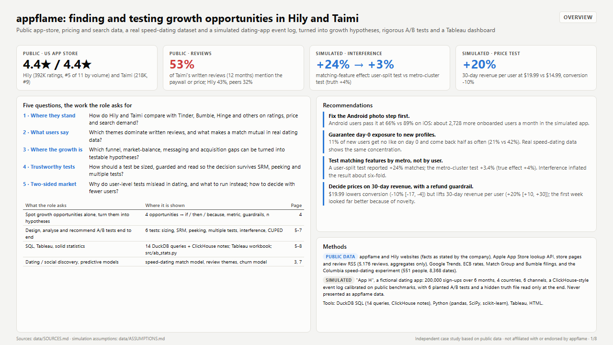
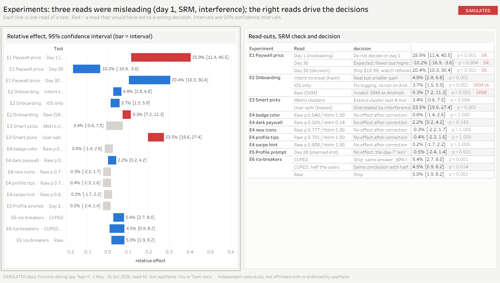

# appflame: finding and testing growth opportunities in Hily and Taimi

Public app-store, pricing and search data, a real speed-dating dataset and a simulated dating-app event log, turned into growth
hypotheses, rigorous A/B tests and a Tableau dashboard.

**Report (8 pages):** [`docs/appflame_Hily_Taimi_growth_case_study.pdf`](docs/appflame_Hily_Taimi_growth_case_study.pdf) ·
**Tableau workbook:** [`tableau/AppH_Product_Analytics.twbx`](tableau/AppH_Product_Analytics.twbx) (4 dashboards, opens in the free Tableau Public app; build guide: [`docs/TABLEAU_BUILD.md`](docs/TABLEAU_BUILD.md)) ·
**HTML fallback dashboard:** [`docs/dashboard.html`](docs/dashboard.html) (same 4 views, one offline file) ·
**Notebook:** [`notebooks/appflame_analysis.ipynb`](notebooks/appflame_analysis.ipynb)

> Independent case study based on public data · not affiliated with or endorsed by appflame.
> Every figure is labelled **PUBLIC DATA** (sourced and dated) or **SIMULATED** (a fictional app, "App H", never presented as appflame, Hily or Taimi data).



## Four key results

1. **PUBLIC — Hily and Taimi rate like the category leaders.** 4.41★ (392K US ratings) and 4.42★ (218K) vs 4.20★ Tinder, 4.32★ Bumble, 4.40★ Hinge;
   both ship often (5.3 and 2.7 versions a month seen in reviews). The same week of Hily Premium costs about 31% more in Europe than in the US (VAT included).
2. **PUBLIC — Users complain about the paywall and fake profiles more than on peer apps,** and real dating data shows why matching needs
   two-sided signals: in the speed-dating experiment 42% say yes but only 16% of dates match; a match model reaches AUC 0.60 on profile data,
   0.73 with behaviour history, 0.84 after a first interaction.
3. **SIMULATED — Four growth opportunities, each a testable hypothesis:** Android loses a third of users at the photo step; 11% of new users
   get no like on day 0 and come back half as often; evening pushes are opened 1.5x more; TikTok cohorts do not pay back (ROAS 0.79).
4. **SIMULATED — Six A/B tests read end to end, each with its trap:** a price test where day 1 and week 1 mislead (decision on 30-day revenue: +20% per user);
   an SRM from an Android logging bug; a two-sided matching feature where a user split reports +24% and a metro-cluster test +3% (true +4%);
   a false winner among five tests removed by Holm; a peeking "win" that vanishes; CUPED reaching the same decision with half the users.



## What is inside

| Folder | Content |
|---|---|
| `sql/` | 14 commented DuckDB queries (funnel, cohort retention, paywall conversion, ARPU/ARPPU, like balance, push hour, channel quality, experiment read-out, SRM, interference, CUPED inputs, churn features, product pulse) with CTEs, window functions and a **ClickHouse equivalent** line (`windowFunnel`, `retention`, `uniqExact`, `quantiles`, `arrayJoin`, `toStartOfWeek`). |
| `src/` | `download_data.py` (public data), `simulate.py` (App H, seed 42), `run_sql.py`, `analysis_public.py`, `analysis_product.py`, `ab_stats.py` (sample size, z-test, Welch t-test, SRM chi-square, Holm/BH, CUPED, O'Brien-Fleming, A/A peeking simulation), `export_tableau.py`, `build_tableau.py` + `twb.py`, `build_dashboard.py`, `build_pdf.py`, `make_notebook.py`. |
| `docs/` | PDF report and page images, [experiment template](docs/EXPERIMENT_TEMPLATE.md) with two filled examples ([E1 price](docs/experiments/E1_paywall_price.md), [E3 smart picks](docs/experiments/E3_smart_picks.md)), [product memo](docs/PRODUCT_MEMO_example.md), [Tableau build guide](docs/TABLEAU_BUILD.md), HTML dashboard. |
| `data/` | `public/` (tidy public tables), `output/` (analysis outputs and Tableau extracts), [`SOURCES.md`](data/SOURCES.md), [`ASSUMPTIONS.md`](data/ASSUMPTIONS.md), `_hidden_truth.csv` (the true simulated effects, kept on purpose and read only at the end of the analysis). `raw/` and `simulated/` are re-created by the scripts. |

## Methods

- **Public data** (15 Nov 2026): appflame.com and hily.com (read in a browser; both refuse scripts), Apple iTunes Lookup API, public App Store
  pages (paths allowed by robots.txt), the App Store review RSS feed (5,176 reviews; nicknames dropped while parsing, review text kept local,
  only aggregates published), Google Trends, ECB rates, Match Group and Bumble filings (orders of magnitude), and the Columbia speed-dating
  experiment (Fisman & Iyengar; used for non-commercial education with citation). No account created, nothing bought; taimi.com refuses automated requests and was not collected.
- **Review themes:** transparent keyword rules, checked on 45 hand-labelled reviews (precision 83%, recall 92%).
- **Speed-dating model:** logistic regression vs gradient boosting, one row per pair, cross-validation by session. No sensitive variable
  (race, religion, origin, income, gender) is used, and no sensitive attribute is analysed or inferred anywhere, including for Taimi.
- **Simulation:** 200,000 sign-ups over 6 months, 4 countries, 6 channels, 40 metros; ClickHouse-style tables (`users`, `events`,
  `daily_activity`, `notifications`, `subscriptions`, `experiments`, `ua_spend`), calibrated on public benchmarks; assumptions in `data/ASSUMPTIONS.md`.
- **Tests:** sample size from a pre-period, pre-registered primary metric and guardrails, SRM check, delta-method confidence intervals,
  cluster analysis at metro level, Holm and Benjamini-Hochberg corrections, O'Brien-Fleming boundary calibrated by simulation, CUPED.
- AI-assisted workflow: I used Claude, mainly to write scripts faster. I drove the project: I defined the questions, chose and validated the data sources, made the analytical decisions and checked every result.

## How to re-run

```
python -m venv .venv
.venv\Scripts\pip install -r requirements.txt
python src/download_data.py      # public data (~10 min, polite pauses)
python src/simulate.py           # App H, seed 42 (~10 s)
python src/run_sql.py            # every query in sql/ -> data/output/sql_*.csv
python src/analysis_public.py
python src/analysis_product.py
python src/export_tableau.py     # CSV + .hyper extracts
python src/build_tableau.py      # tableau/*.twb + .twbx
python src/build_dashboard.py    # docs/dashboard.html
python src/build_pdf.py          # docs/*.pdf + docs/img/*.png (needs Edge or Chrome)
python src/make_notebook.py      # executes notebooks/appflame_analysis.ipynb
```

## Limits

- The simulated app shows methods, not appflame's numbers; effects are planted so each trap is visible.
- App Store data is iOS only (Google Play not collected); written reviews are a negative, self-selected sample.
- Store prices mix VAT-inclusive (EU, UK) and tax-exclusive (US, CA, AU) prices.
- Google Trends values are relative, and "Hily" and "Taimi" are also first names.
- The speed-dating experiment (students, New York, 2002-2004, face to face) informs mechanisms, not app parameters.

## Sources

See [`data/SOURCES.md`](data/SOURCES.md): appflame.com, hily.com, the appflame Product Analyst job post, Apple iTunes Lookup API, App Store pages
and review RSS, Google Trends, ECB reference rates, Match Group investor relations, Bumble Inc. Form 10-Q (Q3 2026), Speed Dating Experiment
(R. Fisman and S. Iyengar, Columbia Business School).
